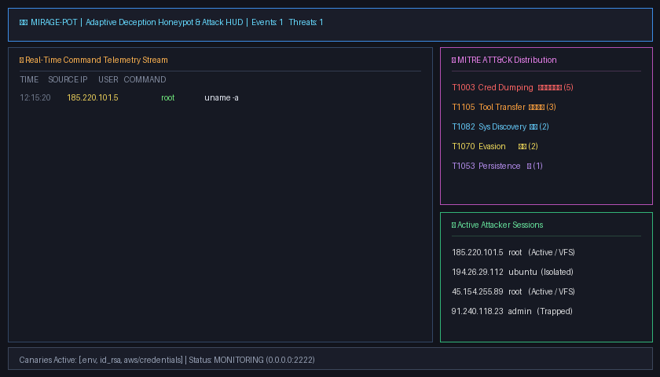

# mirage-pot

> High-concurrency async deception SSH honeypot with in-memory virtual filesystem, dynamic canary credentials, and live MITRE ATT&CK telemetry HUD.



[](https://github.com/omchandra0907-jpg/mirage-pot/actions/workflows/ci.yml)
[](https://opensource.org/licenses/MIT)
[](https://www.python.org/)

> **Live Interactive Web Demo:** [https://omchandra0907-jpg.github.io/mirage-pot/](https://omchandra0907-jpg.github.io/mirage-pot/)

---

## Architectural Highlights

- **High-Concurrency Async Core**: Built on `asyncssh` and `asyncio`, sustaining hundreds of simultaneous automated brute-force attacks on a single event loop without OS thread overhead.
- **Per-Session In-Memory POSIX VFS**: Each incoming session receives an isolated in-memory `VNode` tree (`/etc`, `/root`, `/tmp`, `/bin`). Attackers can inspect files, write scripts, and run shell pipelines (`ls`, `cat`, `cd`, `echo >`, `ps aux`) with guaranteed confinement and zero host disk touches.
- **Dynamic Canary Baiting**: When attackers inspect `.env`, `~/.ssh/id_rsa`, or `~/.aws/credentials`, `mirage-pot` generates unique, traceable credentials tagged with the attacker's `session_id`, turning intrusion attempts into active threat intelligence.
- **Safe Network Tool Emulation**: Fake `wget` and `curl` commands capture destination C2 URLs and write payload stubs locally without executing outbound network requests.
- **Automated MITRE ATT&CK Mapping**: Every executed command is parsed via regex and AST rules to identify threat techniques (`T1082`, `T1003`, `T1105`, `T1070`, `T1057`), streaming structured telemetry to append-only JSONL logs and a live Rich terminal HUD.
- **Interactive Session Replay**: Play back captured bot sessions with exact inter-keystroke timing delays at `1x` or `4x` speed using the built-in CLI.

---

## MITRE ATT&CK Telemetry Mapping

| Technique ID | Name | Trigger Patterns | Action Taken |
|---|---|---|---|
| **`T1082`** | System Information Discovery | `uname -a`, `cat /etc/*release`, `lscpu`, `hostname` | Return realistic Ubuntu 22.04 LTS kernel profile |
| **`T1057`** | Process Discovery | `ps aux`, `ps -ef`, `top`, `pstree` | Emulate realistic multi-user Linux daemon tree |
| **`T1003`** | OS Credential Dumping | `cat /etc/shadow`, `cat ~/.ssh/*`, `cat .env` | Inject session-unique traceable canary bait |
| **`T1105`** | Ingress Tool Transfer | `wget http://...`, `curl -O http://...` | Log C2 endpoint; stage payload without outbound egress |
| **`T1070`** | Indicator Removal on Host | `rm -rf /tmp/*`, `history -c`, `unset HISTFILE` | Maintain in-memory illusion while logging intent |

---

## Quickstart

### Installation
```bash
git clone https://github.com/omchandra0907-jpg/mirage-pot.git
cd mirage-pot
pip install -e .
```

### Run Live Interactive Honeypot
```bash
# Starts SSH listener on 0.0.0.0:2222 with live attack HUD
mirage-pot --port 2222
```

### Replay Captured Intrusion Sessions
```bash
# Replay captured session at 1x speed
mirage-pot replay samples/session_01.jsonl

# Fast playback at 4x speed
mirage-pot replay samples/session_01.jsonl --speed 4
```

---

## Verification & Testing

Execute the comprehensive unit test suite:

```bash
pytest tests/
```

---

## Technical Specifications

| Parameter | Specification |
|---|---|
| **Core Framework** | Python 3.10+ (`asyncio` + `asyncssh`) |
| **File System** | In-Memory `VNode` tree with copy-on-write simulation |
| **Telemetry Format** | Structured JSONL (`timestamp_ms`, `session_id`, `src_ip`, `cmd`, `mitre_id`) |
| **Terminal UI** | Rich live HUD displaying real-time session table, credentials, and MITRE alerts |
| **Web UI** | Web SSH terminal emulator + live SOC HUD dashboard |

---

## License

Distributed under the MIT License. Developed by [Om Chandra](https://github.com/omchandra0907-jpg).
